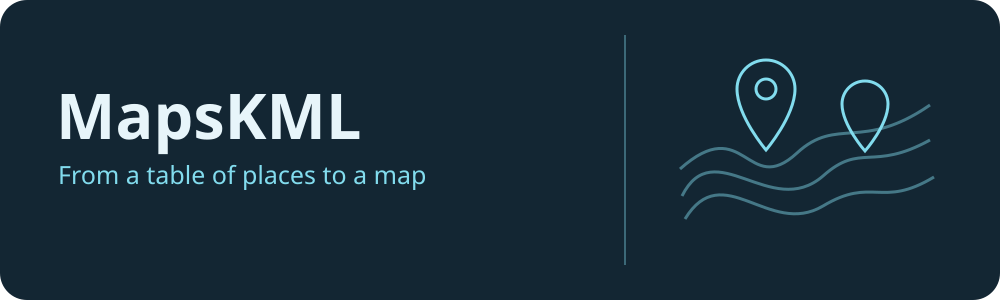

# MapsKML

Turn a CSV of places into a KML map. The script adds coordinates where needed and assigns pin styles according to rules in YAML.

## Table of Contents

- [Overview](#overview)
- [Technologies](#technologies)
- [Getting Started](#getting-started)
- [Usage](#usage)

## Overview

The script reads CSV rows and a YAML mapping, applies description and style rules, and writes a KML file. Later matching styles override earlier ones.

## Technologies

- [Python](https://www.python.org/)
- [pyKML](https://pypi.org/project/pykml/)
- [lxml](https://lxml.de/)
- [PyYAML](https://pyyaml.org/)
- [Google Maps Geocoding API](https://developers.google.com/maps/documentation/geocoding/overview)

## Getting Started

Review [`config.yml`](config.yml), [`requirements.txt`](requirements.txt), and the [`parsecsv.py`](parsecsv.py) source. The script imports PyYAML although the checked-in requirements don't declare it. A clean setup hasn't been tested.

## Usage

Start with a CSV of public landmarks. Geocoding sends addresses to Google and requires a key. Keep credentials out of commits, avoid entering private addresses, and review the resulting KML before sharing it.
